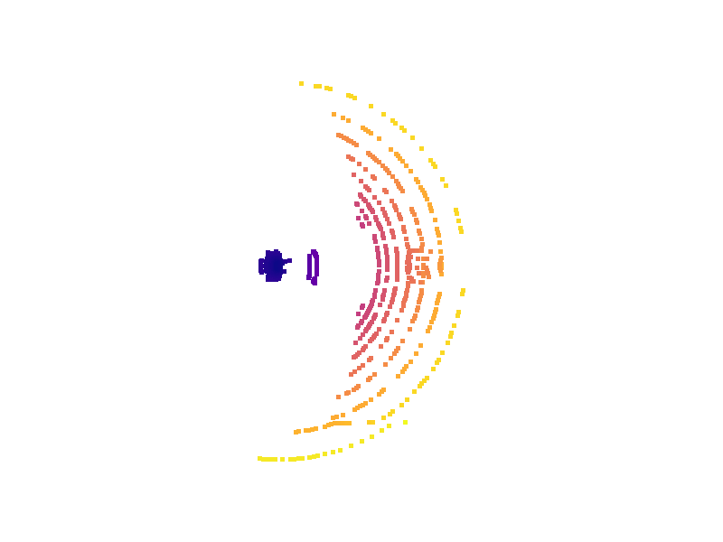
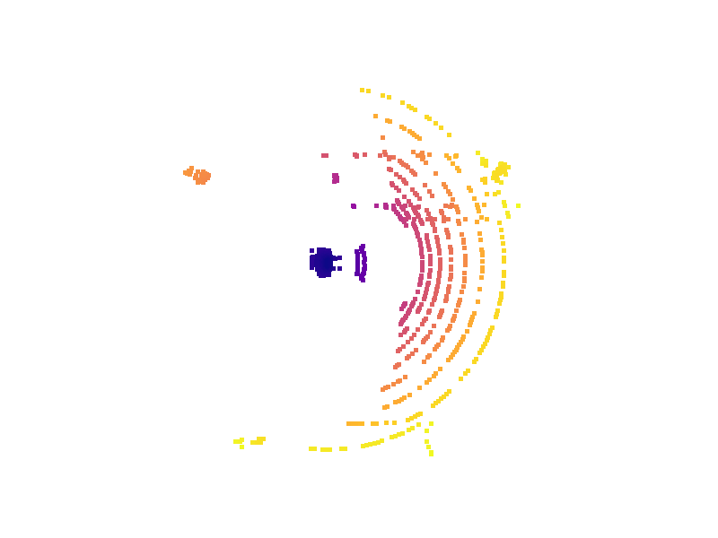
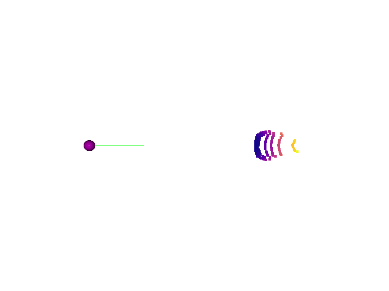
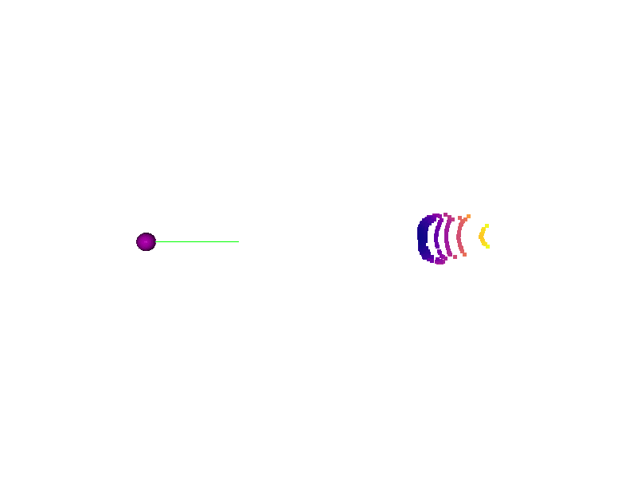
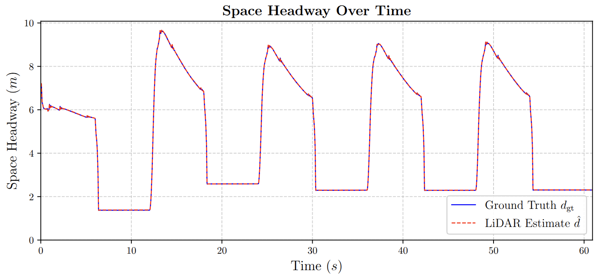
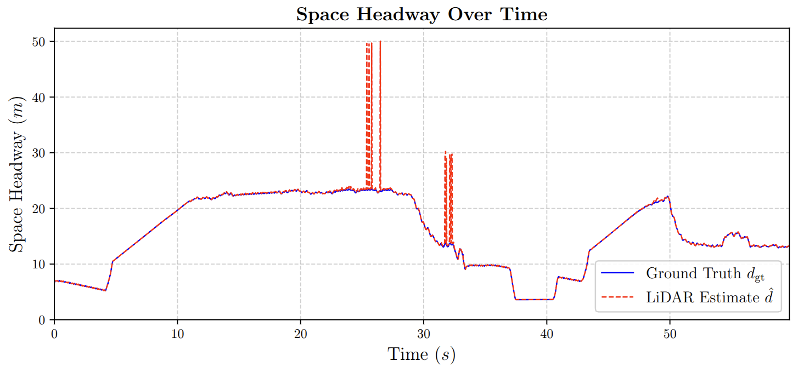

# CARLA ROS 2 Simulation

A simulation environment bridging **CARLA 0.9.16** and **ROS 2 Humble** for multimodal data extraction (Camera, LiDAR, IMU, GNSS) and autonomous vehicle testing.

---

## Architecture Overview

### Ego Vehicle

- Tesla Model 3 (`role_name: tesla_ego`)

### Leader Vehicle

- Lincoln MKZ 2020 (`role_name: leader`)
- Predefined 1km route waypoint navigation

### Sensors

- IMU
- GNSS
- Front Camera (RGB)
- Top LiDAR (32-Channel)

---

## Tested Environment/Prerequisites

| Component | Version |
|-----------|---------|
| Ubuntu | 22.04 |
| ROS 2 | Humble |
| CARLA | 0.9.16 |
| Python | 3.10 |
| Unreal Engine | CARLA Built-in |
| NumPy | 1.x (required, `cv_bridge` breaks under NumPy 2.x) |
| GPU | RTX 4090 (or similar CUDA-capable GPU) |
| PyTorch | CUDA build, verify with `python3 -c "import torch; print(torch.cuda.is_available())"` |
| Ultralytics | Recent enough to include YOLO26 (`pip install -U ultralytics` if `yolo26x-depth.pt` isn't recognized) |

---

## Package Overview

The core ROS 2 package is `carla_ros_sim`. The source is organized into modular files under `src/carla_ros_sim/carla_ros_sim/`:

| File | Description |
|---|---|
| `vehicle_spawner.py` | Main ROS 2 node. Connects to CARLA, spawns vehicles, attaches sensors, runs the control loop, and manages simulation lifetime via a configurable duration timer |
| `carla_env.py` | Environment class handling CARLA client connection, vehicle spawning, ground truth calculation, spectator camera, and Traffic Manager configuration for both custom and default map modes |
| `sensors.py` | Sensor attachment manager. Configures and spawns IMU, GNSS, RGB camera, and 32-channel LiDAR onto the ego vehicle |
| `controllers.py` | PID longitudinal controller for ego vehicle gap tracking, and stop-and-go wave logic for the leader vehicle on the custom straight road |
| `lidar_headway_estimator.py` | ROS 2 node that subscribes to the raw LiDAR point cloud, applies a 3D bounding box ROI filter, estimates space headway via radial distance, publishes both the scalar headway and the filtered ROI point cloud, and logs results to a timestamped CSV |
| `camera_headway_estimator.py` | ROS 2 node that subscribes to the ego front camera, runs YOLOv8 vehicle detection plus a YOLO26-depth model, samples a small median-filtered patch around the leader vehicle's ground-contact point, applies an offline-fit affine calibration, publishes the corrected scalar headway, and logs results to a timestamped CSV. Active model/calibration variant is set via the constants block at the top of the file |
| `ml_headway_estimator.py` | ROS 2 node that subscribes to the LiDAR and camera headway topics, waits for a fresh valid reading from both, and runs an ONNX-exported MLP fusion model (trained offline via `fusion/train_mlp_fusion.py`) to publish and log the final fused headway estimate. Model variant is set via `MODEL_DIR` at the top of the file |

---

## Installation & Workspace Setup

### Automated (recommended): `run_simulation.sh`

A single script sequences CARLA server startup, the ROS bridge, `rqt_plot` (all four
headway sources, live), and the simulation launch — with correct shutdown ordering when
it finishes (CARLA and the bridge can't be killed simultaneously without leaving an
orphaned process holding the network port — see the script's own comments).

**One-time setup:**
```bash
cd ~/carla_simulation_ws
cp run_simulation.env.example run_simulation.env
chmod +x run_simulation.sh
```

Edit `run_simulation.env` with your real paths:
```CARLA_DIR=/path/to/CARLA_0.9.16
CARLA_BRIDGE_DIR=/path/to/carla_ros_bridge
WORKSPACE_DIR=/path/to/carla_simulation_ws
```
**Usage:**
```bash
./run_simulation.sh              # debug run: no bag, 60s duration
./run_simulation.sh true 60      # recorded run, 60 seconds
```

`rqt_plot` opens automatically, pre-populated with ground truth, LiDAR, camera, and
ML-fused headway and no separate Terminal 4 step needed for a normal run.

### Manual, step-by-step (for debugging, or understanding what the script automates)

The same pipeline can also be run across 4 terminals directly:

### 1. Setup the ROS 2 Workspace
Create a new workspace and clone the repository inside this directory:

```bash
mkdir -p ~/carla_simulation_ws
cd ~/carla_simulation_ws
git clone https://github.com/nsriad/carla_ros2_simulation.git
```

### 2. Install Python Dependencies

**Install system-wide (`pip3 install --user ...`), not only inside a virtual environment.**
ROS 2 node executables run under the system Python interpreter regardless of which venv
is active in your terminal. Packages installed only inside a venv are invisible to the
running nodes and cause `ModuleNotFoundError` at launch.

```bash
pip3 install --user "numpy<2" onnxruntime torch ultralytics timm opencv-python
```

- `numpy<2` is required, `cv_bridge` breaks under NumPy 2.x, and the packages above can
  silently pull in NumPy 2.x as a dependency if this isn't pinned first
- If install fails with an `invalid-installed-package` error mentioning `flatbuffers`, retry
  with `pip3 install --user --ignore-installed flatbuffers <package>`, a known conflict
  with an old system `python3-flatbuffers` apt package
- `ultralytics` must be recent enough to include YOLO26:
  `pip3 install --user -U ultralytics` if a `yolo26*-depth.pt` checkpoint isn't recognized

`data_analysis/`'s offline scripts can additionally use the `carla_env` virtual environment
from Terminal 3 below, but anything the **live ROS 2 nodes** import must be available
system-wide regardless of that venv.

### 3. Build the Package
From the root of the cloned repository, build the package using `colcon`. Using the `--symlink-install` flag is recommended for Python packages so you do not have to rebuild every time you edit a script.

```
source /opt/ros/humble/setup.bash
colcon build --packages-select carla_ros_sim --symlink-install
```
Once built, source the local setup file so the ROS 2 CLI can find your package. You must do this in every new terminal before running the nodes:
```
source install/setup.bash
```

## Running the Simulation

The pipeline is designed to run across **5 terminals**.

### Terminal 1: Launch CARLA Server

Navigate to your CARLA installation directory and launch the simulation environment:

```bash
./CarlaUE4.sh
```
*Note: Append `-RenderOffScreen` for maximum performance during data collection, `-quality-level=Low` for testing with low memory usage, or `-quality-level=Epic` for maximum visual quality.*

---

### Terminal 2: Launch CARLA ROS Bridge

Navigate to your CARLA ROS bridge workspace and source its installation to make the launch files available. Then, launch with either a default CARLA town or a custom OpenDRIVE map. (defaulted to 10 FPS for synchronized RGB and LiDAR data collection):

**Default CARLA town (e.g. Town04):**

```bash
source ~/carla_ros_bridge/install/setup.bash

ros2 launch carla_ros_bridge carla_ros_bridge.launch.py \
  town:=Town04 \
  timeout:=30 \
  fixed_delta_seconds:=0.1 \
  synchronous_mode:=True \
  use_sim_time:=True
```

**Custom straight highway map:**

```bash
ros2 launch carla_ros_bridge carla_ros_bridge.launch.py \
  town:=/home/ruby/Nazmus_Shakib/Summer_26/carla_simulation_ws/custom_maps/straight_highway.xodr \
  timeout:=30 \
  fixed_delta_seconds:=0.1 \
  synchronous_mode:=True
```

*Note: `synchronous_mode:=True` is required. Running asynchronously causes sensor frame desynchronization and data loss. For smoother simulation when heavy sensor streams are disabled, adjust `fixed_delta_seconds` to `0.033` (30 FPS) or `0.016` (60 FPS).*

---

### Terminal 3: Launch Vehicle Spawner

Navigate to the local ROS 2 workspace, source it, and start the ego vehicle with its sensors:

```bash
cd ~/carla_simulation_ws
source install/setup.bash
ros2 launch carla_ros_sim sim_launch.py record:=true duration:=60
```

*Note: unlike the offline `data_analysis/` scripts, the live ROS 2 nodes run under the
system Python interpreter regardless of any active virtual environment, see
"Install Python Dependencies" above. No venv activation is needed here.*

*As of the current launch file, the whole pipeline stops automatically when `vehicle_spawner`
finishes (at `duration` seconds). No manual Ctrl+C needed for a normal run.*

**Launch arguments:**

| Argument | Default | Description |
|---|---|---|
| `record` | `false` | Enable ROS bag recording |
| `duration` | `60` | Simulation duration in seconds. Set to `0` to run indefinitely |

The launch file starts five processes simultaneously: `vehicle_spawner`, `lidar_headway_estimator`, `camera_headway_estimator`, `ml_headway_estimator`, and the ROS bag recorder (when `record:=true`). The bag is saved to `data/multimodal_dataset_YYYYMMDD_HHMMSS/` automatically.

**To switch between custom map and default town mode**, change the following flag inside `vehicle_spawner.py` before building:

```python
self.env = CarlaEnvironment(use_custom_map=True)   # custom straight road
self.env = CarlaEnvironment(use_custom_map=False)  # default CARLA town
```

---

### Terminal 4: rqt_plot (live view)

Already opened automatically by `run_simulation.sh` — see below. To open manually
against a simulation started via the manual Terminal 1-3 steps:

To compare all four headway sources live:
```bash
ros2 run rqt_plot rqt_plot \
  /carla/tesla_ego/ground_truth_headway/data \
  /carla/tesla_ego/lidar_headway/data \
  /carla/tesla_ego/camera_headway/data \
  /carla/tesla_ego/ml_headway/data
```

To plot linear acceleration in real-time:

```
ros2 run rqt_plot rqt_plot /carla/tesla_ego/imu_sensor/linear_acceleration/x
```
To plot your Latitude and Longitude moving in real-time:
```
ros2 run rqt_plot rqt_plot /carla/tesla_ego/gnss_sensor/latitude /carla/tesla_ego/gnss_sensor/longitude
```

**Working directory: every relative path in this project depends on it.**
- Offline analysis scripts (`headway_analysis.py`, everything in `camera/`, `fusion/`, `parsers/`) are run **from `data_analysis/`**, they reference data as `../data/...`
- The live ROS 2 simulation (`ros2 launch ...` or `run_simulation.sh`) is run **from the workspace root** (`~/carla_simulation_ws`), live nodes write CSVs as `data/headway_csv/...`, relative to wherever the launch was invoked from

Running either from the wrong directory doesn't error clearly — it silently creates a new, empty `data/` folder or fails to find a file that does exist, just in a different place.

---


## Data Post-Processing

Navigate to `data_analysis/` and run the pipeline shell scripts.

### Pipeline Scripts

| Script | Description |
|---|---|
| `parse_data.sh` | Extracts camera frames, LiDAR point clouds and IMU/GNSS data from the ROS bag into structured output directories |
| `post_process.sh` | Generates camera GIF, LiDAR timelapse animation, and headway plots from the parsed data |
| `camera_process.sh` | Runs the full camera pipeline: YOLO detection → missing/multi-vehicle frame checks → ZoeDepth estimation → calibration |
| `run_all.sh` | Master script, runs all three of the above in order for one dataset |

### Quick Start: Full Pipeline

```bash
cd data_analysis/

./run_all.sh 20260617_103550
```

This runs `parse_data.sh`, `post_process.sh`, `camera_process.sh`, then `headway_analysis.py`, in order, for one dataset. The datetime argument matches the folder name suffix: `multimodal_dataset_20260617_103550`.

### Running Steps Individually

Each stage can also be run on its own, useful when debugging one step without
re-running everything:

```bash
# step 1: extract all sensor data from bag
./parse_data.sh 20260617_103550

# step 2: generate visualizations
./post_process.sh 20260617_103550

# step 3: camera detection, depth estimation, and calibration
./camera_process.sh 20260617_103550

# step 4: final LiDAR vs camera vs ground truth comparison plots
python3 headway_analysis.py 20260617_103550
```

### Skipping Steps

Both `run_all.sh` and `camera_process.sh` accept skip flags, so you can re-run
just the step you're actively debugging instead of the whole pipeline:

```bash
# only re-run calibration, skip everything before it
./camera_process.sh 20260617_103550 --skip-yolo --skip-missing --skip-multi --skip-depth

# only re-run the camera pipeline, skip parsing and post-processing
./run_all.sh 20260617_103550 --skip-parse --skip-post --camera-args="--skip-yolo"
```

Output from `camera_process.sh` (including console output from the diagnostic
scripts, which would otherwise scroll past and be lost) is also saved to
`../data/reports/report_20260617_103550.txt` for later reference.

---

## Data Organization

Two independent naming conventions are used, and they answer two different questions —
mixing them up is a common source of confusion.

### `<DATETIME>`: which recording session

Every live simulation run gets one timestamp (the `session_id` passed by `sim_launch.py`),
shared across every file that recording produced:

| File | Produced by |
|---|---|
| `data/multimodal_dataset_<DATETIME>/` | The rosbag (if `record:=true`) |
| `data/headway_csv/headway_log_<DATETIME>.csv` | `lidar_headway_estimator.py` |
| `data/headway_csv/camera_headway_log_<DATETIME>.csv` | `camera_headway_estimator.py` |
| `data/ml_inference_log_<DATETIME>.csv` | `ml_headway_estimator.py` |

`headway_analysis.py <DATETIME>` and `fusion/plot_ml_prediction.py <DATETIME>` both take
this same value to know which run to process.

### `_<variant>` — which offline processing configuration

Within one dataset folder, the same raw data can be reprocessed multiple times with
different camera/fusion settings (e.g. testing `yolo26n` vs `yolo26x`, with or without
patch sampling). Each configuration gets its own suffix so results never overwrite
each other:

| Folder/file pattern | Produced by |
|---|---|
| `processed_camera_<variant>/` | `camera_headway_estimation_yolo26.py --output_dir` |
| `processed_fusion_<variant>/` | `train_mlp_fusion.py --output_dir` |
| `merged_cam_lid_gt_<variant>.csv` | `headway_analysis.py <DATETIME> processed_camera_<variant>` |

The plain (no-suffix) versions like `processed_camera/`, `processed_fusion/`,
`merged_cam_lid_gt.csv` are the ZoeDepth/default configuration. `camera_calibrate.py`
picks the *most recently modified* `camera_calibrated_*.csv` in whichever `--cam_dir`
it's pointed at — always point it at the specific variant folder you mean, rather than
relying on modification-time ordering across runs.

---

## YOLOv8 Vehicle Detection on CARLA Frames

Pipeline order: `yolo_detection.py` -> `camera_headway_estimation.py` -> `camera_calibrate.py`

```bash
# install dependencies
bash setup.sh

# run detections on your CARLA frames
python3 camera/yolo_detection.py \
  --frames_dir ../data/town04_leader_50_multimodal_dataset_20260618_102918/processed_camera/images \
  --conf_thresh 0.3 \
  --exclude_bottom_px 40
```

### Key Flags

| Flag | Description |
|---|---|
| `--conf_thresh` | YOLO detection confidence threshold (default: 0.30) |
| `--exclude_bottom_px` | Masks out this many pixels from the bottom of each frame before detection, to exclude the ego vehicle's own hood/bumper from being misdetected as a second vehicle. Check a few annotated images to pick the right value — the excluded region is shaded red in the output. Default: 0 (no masking) |
| `--num_frames` | Number of frames to sample evenly across the sequence. Omit to run on all frames |
| `--model` | YOLOv8 model variant (see table below) |

### Model Options

| Model       | Speed     | Accuracy | When to use                    |
|-------------|-----------|----------|--------------------------------|
| `yolov8n.pt`| ~5ms/img  | Good     | Default, fast iteration        |
| `yolov8s.pt`| ~10ms/img | Better   | If nano misses some vehicles   |
| `yolov8m.pt`| ~25ms/img | Best     | Final results for the paper    |

Switch with `--model yolov8s.pt`.

### Diagnostic Scripts

| Script | Description |
|---|---|
| `camera/find_multi_car_frame.py` | Flags frames where YOLO detected more than one vehicle, for reviewing duplicate/false-positive detections |
| `camera/missing_leader_frame.py` | Flags frames with no valid leader-vehicle detection (below confidence threshold or occluded) |

### Output schema (detections.csv)

| Column                | Description                                      |
|-----------------------|--------------------------------------------------|
| `frame`               | Filename                                         |
| `class`               | car / truck / bus / motorcycle                   |
| `confidence`          | Detection confidence [0, 1]                      |
| `bbox_bottom_center_x`| Horizontal center of box bottom edge             |
| `bbox_bottom_center_y`| Vertical position of box bottom (ground contact) |

---

## Depth Estimation

Two depth backends are supported. **YOLO26-depth is the current default** which is dramatically faster (~23×) with comparable or better accuracy once calibrated for this domain. ZoeDepth remains available and is documented below for reference.

### YOLO26-depth (default)

Pipeline order: `yolo_detection.py` → `camera_headway_estimation_yolo26.py` → `camera_calibrate.py`

```bash
python3 camera/camera_headway_estimation_yolo26.py \
  --camera_dir ../data/multimodal_dataset_20260713_191320/processed_camera \
  --model yolo26x-depth.pt --patch_radius 4 \
  --output_dir ../data/multimodal_dataset_20260713_191320/processed_camera_yolo26x_patch
```

Reuses the existing `detections_*.csv` from `yolo_detection.py` — only the depth backend changes, detection stays the same.

**Key flags:**

| Flag | Description |
|---|---|
| `--model` | YOLO26-depth checkpoint (see table below) |
| `--patch_radius` | Sample a median over a `(2r+1)×(2r+1)` pixel window instead of one pixel at the vehicle's bottom-center point. Window extends *upward* into the vehicle body only, never below the point into the road. `0` = single pixel |
| `--imgsz` | Inference resolution, default `768` (matches the released weights' training resolution) |
| `--output_dir` | Where results are written. Defaults to a sibling `processed_camera_<name>` folder, so testing a variant never overwrites another one's results |

**Model comparison** (measured on this project's CARLA dataset, calibrated, single-pixel sampling unless noted):

| Model | MAE | RMSE | Speed | Notes |
|---|---|---|---|---|
| `yolo26n-depth.pt` | 4.37 m | 4.95 m | ~19 ms/frame | Fast, but noticeably less accurate on this outdoor/long-range domain |
| `yolo26x-depth.pt` | 2.48 m | 2.98 m | ~18.7 ms/frame | Same speed as nano |
| `yolo26x-depth.pt` + `--patch_radius 4` | 2.42 m | 2.92 m | ~19 ms/frame | Marginal gain over single-pixel; **current deployed configuration** |

For comparison, ZoeDepth (below) reaches 1.65 m MAE at ~440 ms/frame — YOLO26x is the accuracy/speed tradeoff currently in production; see `troubleshooting.md` for the domain-mismatch discussion behind nano's weaker result.

Calibrate with the new output directory:
```bash
python3 camera/camera_calibrate.py \
  --gt_csv ../data/headway_csv/headway_log_20260713_191320.csv \
  --cam_dir ../data/multimodal_dataset_20260713_191320/processed_camera_yolo26x_patch/ \
  --gt_time_col timestamp --gt_dist_col gt_headway_m
```

The resulting `a`/`b` constants go into `camera_headway_estimator.py`'s `CALIB_A`/`CALIB_B` block (see Package Overview above) — the same block also sets which `--model`/`--patch_radius` variant runs live.


### ZoeDepth (alternative)

This project uses the official ZoeDepth models loaded via PyTorch Hub. Depending on the environment, different model weights can be loaded:

* **`ZoeD_K` (Default):** Trained on the KITTI dataset. Highly tuned for outdoor scenes and dashboard camera views. This is the default setting for our CARLA simulation pipeline.
* **`ZoeD_N`:** Trained on the NYU-Depth-V2 dataset. Tuned specifically for indoor environments.
* **`ZoeD_NK`:** A multi-headed model jointly trained on both NYU and KITTI datasets, capable of handling both indoor and outdoor domains.

By default, the script loads `ZoeD_K` for optimal outdoor structural estimation:
```python
zoe = torch.hub.load("isl-org/ZoeDepth", "ZoeD_K", pretrained=True, trust_repo=True).to(device).eval()

Run the following script:

```bash
python3 camera/camera_headway_estimation.py \
  --camera_dir ../data/town04_leader_50_multimodal_dataset_20260618_102918/processed_camera
```

This uses `detections.csv` and produces a raw (uncalibrated) metric depth estimate per frame. To calibrate further and get a reliable depth estimate, run:

```bash
python3 camera/camera_calibrate.py \
  --gt_csv ../data/headway_csv/headway_log_20260618_102918.csv \
  --cam_dir ../data/town04_leader_50_multimodal_dataset_20260618_102918/processed_camera \
  --gt_time_col timestamp \
  --gt_dist_col gt_headway_m
```

---

## Sensor Fusion

### Merging camera + LiDAR + ground truth

Before fusion training can run, calibrated camera and LiDAR/ground-truth data need to be time-aligned into one file. This is `headway_analysis.py`'s job, not `fusion/`'s:

```bash
python3 headway_analysis.py 20260713_191320
```

To merge a *specific* calibrated camera variant instead of the default `processed_camera/` folder, pass its subdirectory name as a second argument:
```bash
python3 headway_analysis.py 20260713_191320 processed_camera_yolo26x_patch
```
Output filename tracks the variant automatically as `merged_cam_lid_gt.csv` for the default, `merged_cam_lid_gt_yolo26x_patch.csv` for a named variant. So testing multiple camera configurations never overwrites another's merged data.

### Training fusion models

Located in `fusion/`. Combines calibrated camera and LiDAR headway estimates into
a single fused estimate, using a shared time-block train/test split (first half
of the drive trains, second half evaluates) rather than a random shuffle, since
consecutive frames are temporally correlated.

| Script | Method |
|---|---|
| `fusion/least_squares_fusion.py` | Linear fusion, `d_fused = θ0 + θ1·lidar + θ2·camera`, fit by ordinary least squares |
| `fusion/train_mlp_fusion.py` | Small MLP fusion (inputs: lidar, camera, optionally `\|lidar - camera\|`), selectable MSE or Huber loss. Exports both an ONNX model and a `.npz` of normalization constants for live deployment |
| `fusion/plot_fusion_comparison.py` | Combined comparison plots across all methods, reads from the shared results file |

**Key `train_mlp_fusion.py` flags:**

| Flag | Description |
|---|---|
| `--merged_csv` | Path to the merged file from the step above |
| `--loss` | `mse` or `huber` (default `huber`) |
| `--no_diff` | Drop the `\|lidar − camera\|` feature. On this dataset it made fusion *worse* (0.834 m vs 0.139 m MAE) — currently always used |
| `--output_dir` | Where the `.onnx`/`.npz` are written. Defaults to `processed_fusion/` next to the merged CSV; use a variant-specific name (e.g. `processed_fusion_yolo26x_patch`) to avoid overwriting another configuration's trained model |

**Usage:**

```bash
python3 fusion/least_squares_fusion.py \
  --merged_csv ../data/multimodal_dataset_20260713_191320/merged_cam_lid_gt.csv

python3 fusion/train_mlp_fusion.py \
  --merged_csv ../data/multimodal_dataset_20260713_191320/merged_cam_lid_gt_yolo26x_patch.csv \
  --loss mse --no_diff \
  --output_dir ../data/multimodal_dataset_20260713_191320/processed_fusion_yolo26x_patch

python3 fusion/plot_fusion_comparison.py \
  --comparison_csv ../data/multimodal_dataset_20260713_191320/processed_fusion_yolo26x_patch/fusion_comparison.csv \
  --zoom_start 120 --zoom_end 128
```

Every fusion script writes into a shared `fusion_comparison.csv` inside its `--output_dir`,
appending its own prediction column (`least_squares_fused`, `mlp_mse_nodiff_fused`,
`mlp_huber_fused`) rather than each script producing a separate output file, so
one plotting script can compare all methods at once.

### Deploying a trained model live

`ml_headway_estimator.py`'s `MODEL_DIR` constant (top of the file) points at whichever `--output_dir` was used above — it expects `mlp_mse_nodiff_fused.onnx` and `mlp_mse_nodiff_fused_normalization.npz` inside that folder. Update it alongside `camera_headway_estimator.py`'s `DEPTH_MODEL`/`CALIB_A`/`CALIB_B` block when switching to a newly trained variant — both blocks together define "which configuration is currently deployed."

---

## Outputs & Data Visualization

The following visualizers demonstrate the synchronized multimodal data extracted from the ROS bag logs.

### Multimodal Sensor Grid

Demonstration of the ego vehicle navigating the cluttered town environment. The left column displays the front-facing RGB camera, and the right column displays the corresponding 32-channel LiDAR `PointCloud2` data (color-mapped for spatial distance).

| Scenario | Camera View | LiDAR Point Cloud |
| :---: | :---: | :---: |
| **Leader-FollowerTracking** |  |  |
| **Baseline Navigation (No Leader)** |  |  |

### ROI-Filtered LiDAR Point Cloud

After applying the 3D bounding box ROI filter, only points belonging to the leader vehicle's rear face are retained. The ego vehicle origin is marked as a fixed reference point (white sphere) with a green arrow indicating the forward direction. Point color encodes radial distance from the ego sensor origin using the plasma colormap (blue = close, yellow = far).

| Scenario | Camera View | ROI LiDAR Point Cloud |
| :---: | :---: | :---: |
| **Custom Straight Road** |  |  |
| **Town04 Highway** |  |  |

### Space Headway Validation

LiDAR-estimated space headway compared against CARLA ground truth for both environments.

| Scenario | Headway Plot |
| :---: | :---: |
| **Custom Straight Road** |  |
| **Town04 Highway** |  |

### IMU Sensor

Extracted linear acceleration data capturing the ego vehicle's longitudinal and lateral dynamics.

[View the IMU Acceleration Plot (PDF)](asset/acceleration_plot.pdf)

---

## Troubleshooting

For known issues and their resolutions, see [troubleshooting.md](troubleshooting.md).